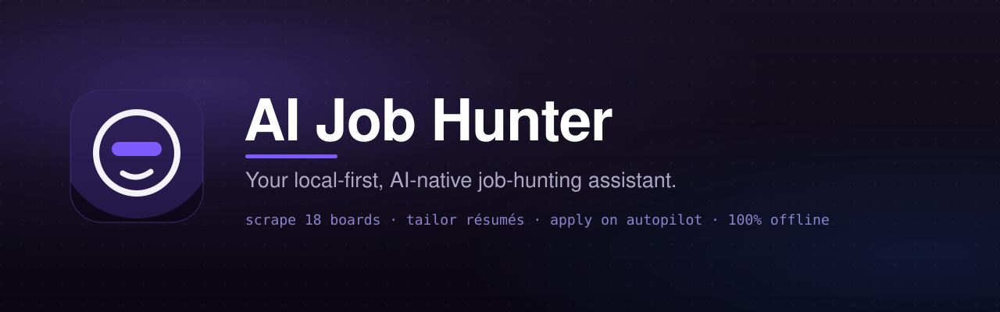
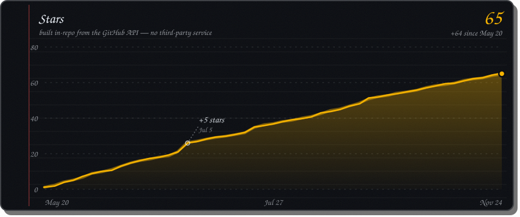

  

<h1 align="center">AI Job Hunter</h1>

  <em>Your local-first, AI-native desktop assistant for job searching, résumé &amp; cover-letter generation, and assisted applications.</em>

  
  
  
  
  

  <a href="https://github.com/saeedkolivand/ai-job-hunter-app/releases"><strong>⬇️ Download</strong></a>
  &nbsp;·&nbsp;
  <a href="https://chromewebstore.google.com/detail/ai-job-hunter-%E2%80%94-job-impor/oaoekkgkhmgdfnpmfkpphgiikliaicll">Chrome extension</a>
  &nbsp;·&nbsp;
  <a href="https://addons.mozilla.org/en-US/firefox/addon/ai-job-hunter/">Firefox extension</a>
  &nbsp;·&nbsp;
  <a href="https://apps.microsoft.com/detail/9nc5kdjv0btm">Microsoft Store</a>
  &nbsp;·&nbsp;
  <a href="https://snapcraft.io/ai-job-hunter">Snap</a>
  &nbsp;·&nbsp;
  <a href="docs/README.md">📚 Docs</a>

## What it does

- **Résumé & cover-letter generation**: streaming generation with your AI provider, DOCX / PDF / TXT export, ATS-safe formatting.
- **Matching & ATS**: scrape job boards, match postings to your résumé, ATS scoring and skill-gap analysis.
- **Autopilot & tracking**: scheduled searches, one-click tailoring, and tracking of everything you apply to.
- **Browser extension**: save jobs in one click from Chrome or Firefox.
- **Bring your own AI**: Ollama (fully offline), OpenAI, Anthropic, Gemini, OpenAI-compatible servers, or CLI agents (Claude Code, Codex, Gemini CLI).

## Install

Grab the latest installer for your OS from **[Releases](https://github.com/saeedkolivand/ai-job-hunter-app/releases)**, or install from a store:

macOS (Homebrew): `brew tap saeedkolivand/ai-job-hunter-app https://github.com/saeedkolivand/ai-job-hunter-app && brew install --cask ai-job-hunter`

No API key needed to start. Per-OS notes, building from source and troubleshooting: **[docs/INSTALLATION.md](docs/INSTALLATION.md)**.

## Privacy

- Your data is stored on your device (SQLite + OS keychain); there is no app-operated backend and no behavioural analytics.
- Two calls happen automatically: the update check (app version and OS/architecture only) and crash reports (redacted, on by default, switchable off in Settings → Privacy).
- Everything else goes only to services you configure or invoke, such as your AI provider or the job boards you scrape. Full detail: **[docs/PRIVACY.md](docs/PRIVACY.md)**.

## How the AI is kept honest

- Grounding is enforced in Rust: every claim traces back to your source résumé or the job ad, and the evidence is selected without a model call.
- Every Critical is deterministic, never a model opinion.
- A fabrication-review gate refuses to save a run with unresolved flagged claims until you decide.
- Anything you did not type (job ads, prior model output, web research) is fenced as untrusted text in prompts.

Full mechanism and what is (not) measured: **[docs/AI_HONESTY.md](docs/AI_HONESTY.md)**.

## Docs

[Features](docs/FEATURES.md) · [Installation](docs/INSTALLATION.md) · [Usage](docs/USAGE.md) · [Configuration](docs/CONFIGURATION.md) · [Privacy](docs/PRIVACY.md) · [Development](docs/DEVELOPMENT.md) · **[All docs →](docs/README.md)**

## Contributing

See [CONTRIBUTING.md](CONTRIBUTING.md) for branching, commit conventions, and PR guidelines. All changes go through PRs; never push directly to `main`.

## Security

Found a vulnerability? Report it privately: see **[SECURITY.md](SECURITY.md)**. Don't open a public issue.

## License

**Apache License 2.0** ([`Apache-2.0`](LICENSE)): open source, free for any use including commercial, with an explicit patent grant.

One carve-out: the vendored ATS company datasets under `apps/desktop/src-tauri/ats-slugs/` are third-party data under **CC BY-NC 4.0**, not Apache-2.0 — see [their README](apps/desktop/src-tauri/ats-slugs/README.md) before redistributing commercially.

## 💛 Fund the job hunt

This project is built by a guy who is, himself, still unemployed, a cry for help made between rejections. If it's saving you time or sanity, consider a voluntary gift:

<a href="https://github.com/sponsors/saeedkolivand" target="_blank" rel="noopener noreferrer">GitHub Sponsors</a> · <a href="https://ko-fi.com/saeedkolivand" target="_blank" rel="noopener noreferrer">Ko-fi</a> · <a href="https://paypal.me/saeedkolivand" target="_blank" rel="noopener noreferrer">PayPal</a>

## ⚖️ Responsible Use

- **Respect each site's Terms of Service.** Some job boards allow only manual access or their official APIs; automated collection (or signing in with your own account to scrape) may breach their terms and can get your account suspended. You choose which boards to enable and accept that responsibility.
- **Not affiliated.** AI Job Hunter is an independent project, not affiliated with, endorsed by, or sponsored by LinkedIn, Indeed, Glassdoor, Xing, StepStone, or any other job board or company named in this repository. Product names and trademarks belong to their respective owners.
- **Your data stays yours.** Processing is local-first and single-user; the project maintainers do not receive, store, or process your data. Bring-your-own-key means AI prompts go only to the provider you configure.
- **No warranty.** Provided "as is" under the Apache License 2.0, without warranty of any kind and without liability for how it is used. This is not legal advice.

<h2 align="center">Contributors</h2>

  

<h2 align="center">Growth</h2>

  

  

<em>Both charts are generated in-repo by <a href=".github/workflows/repo-charts.yml">📈 Repo Charts</a> and served from the <code>badges</code> branch &mdash; no third-party service.</em>

