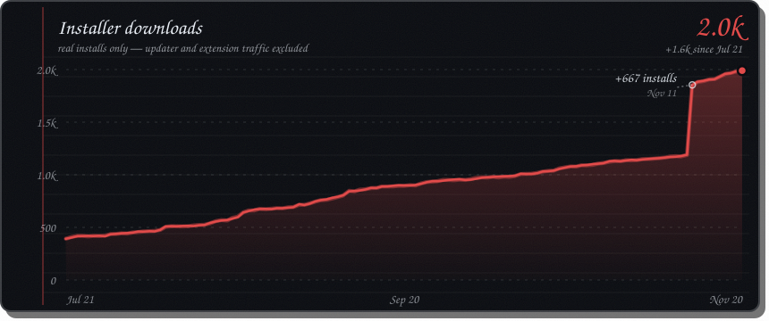

<p align="center">
  
</p>

<h1 align="center">AI Job Hunter</h1>

<p align="center">
  <em>Your local-first, AI-native desktop assistant for intelligent job searching, résumé &amp; cover-letter generation, and assisted applications. Run it fully offline with Ollama, plug in your own OpenAI, Anthropic, or Gemini key, or route it through an AI CLI agent (Claude Code, Codex, Gemini CLI).</em>
</p>

<p align="center">
  <a href="https://github.com/saeedkolivand/ai-job-hunter-app/releases"><strong>⬇️ Download the latest release</strong></a>
  &nbsp;·&nbsp;
  <a href="https://aijobhunter.app">🌐 Live site</a>
  &nbsp;·&nbsp;
  <a href="https://aijobhunter.app/creature">🎬 Short film</a>
  &nbsp;·&nbsp;
  <a href="#install">📦 Install</a>
  &nbsp;·&nbsp;
  <a href="#features">✨ Features</a>
  &nbsp;·&nbsp;
  <a href="docs/">📚 Docs</a>
</p>

<p align="center">
  <a href="https://github.com/saeedkolivand/ai-job-hunter-app/releases"></a>
  <a href="https://github.com/saeedkolivand/ai-job-hunter-app/releases"></a>
  <a href="https://github.com/saeedkolivand/ai-job-hunter-app/actions/workflows/ci-pipeline.yml"></a>
  <a href="https://github.com/saeedkolivand/ai-job-hunter-app/commits/main"></a>
  <a href="LICENSE"></a>
</p>

<p align="center">
  <a href="https://github.com/saeedkolivand/ai-job-hunter-app/releases"></a>
  <a href="https://aijobhunter.app"></a>
  <a href="https://chromewebstore.google.com/detail/ai-job-hunter-%E2%80%94-job-impor/oaoekkgkhmgdfnpmfkpphgiikliaicll"></a>
  <a href="https://addons.mozilla.org/en-US/firefox/addon/ai-job-hunter/"></a>
  <a href="SECURITY.md"></a>
  <a href="https://github.com/saeedkolivand/ai-job-hunter-app/stargazers"></a>
  <a href="https://github.com/saeedkolivand/ai-job-hunter-app/pulls"></a>
</p>

<p align="center">
  <a href="https://tauri.app"></a>
  <a href="https://www.rust-lang.org/"></a>
  <a href="https://www.typescriptlang.org/"></a>
  <a href="https://react.dev/"></a>
  <a href="https://tailwindcss.com/"></a>
  <a href="https://ollama.com/"></a>
</p>

---

## Quick Start

```bash
# 🚀 Try it           → download a build for your OS:
#                        https://github.com/saeedkolivand/ai-job-hunter-app/releases
#
# 🛠️  Develop it       → run the full desktop app from source:
git clone https://github.com/saeedkolivand/ai-job-hunter-app.git
cd ai-job-hunter-app && pnpm install
ollama pull mistral   # optional: a local model for the offline Ollama provider
pnpm dev              # launches the Tauri app with hot reload
```

No API key required to start. Run fully offline with [Ollama][ollama], or add a cloud key later in **Settings → AI**. New here? See **[docs/INSTALLATION.md](docs/INSTALLATION.md)** for per-OS notes and troubleshooting.

## What It Does

AI Job Hunter is a desktop application built with **[Tauri][tauri]** (a [Rust][rust] core with a [React][react] renderer) that brings AI-driven job hunting to your local machine. It scrapes 24 job boards (including an Adzuna/JSearch aggregator that covers walled boards like Indeed, Glassdoor, and Xing, plus company-scoped ATS boards like Greenhouse and Lever), semantically matches postings to your résumé, generates tailored cover letters and résumés with your AI provider of choice, drafts grounded answers to application questions, and tracks everything you apply to, all while keeping your data and credentials on your device.

Your résumés, generations, applications, and tracked job data live in a local SQLite database on your device (credentials live in the OS keychain); there is **no app-operated backend** collecting them, and no behavioural analytics. **Two things happen automatically, without you asking:** the app checks for updates (GitHub, 10 s after launch then every 4 h, transmitting only your app version and OS/architecture), and sends crash reports to Sentry (error + stack trace, OS, app version) when the app breaks — the latter is on by default, asked during setup, switchable off in Settings → Privacy, and redacted of paths, links, hosts, e-mails and credentials before sending. The app's other outbound calls go to services **you** configure or invoke: your AI provider (which receives the résumé and job text you ask it to generate from), job boards you scrape (including the Adzuna, JSearch/RapidAPI, Jooble, Apify and freehire aggregator tiers — freehire being the one that needs no key, tried last), an optional web search you explicitly enable (your provider's own, then a SearXNG-compatible server you set (SearXNG or RustXNG, no key; queries go to that server), then Exa if you add a key; the next runs only when one fails on billing or sign-in), location autocomplete (Photon, with offline fallback), opt-in company-logo enrichment (Clearbit, default **off**), opt-in email-confirmation watching via IMAP (credential user-supplied and OS-keychain-backed; email content never leaves the device), opt-in self-hosted sync between your own devices (default **off**; it sends the same data an app backup holds — applications and their status history, documents, generations, contact profile, job preferences and AI provider routing, never passwords or API keys — only to a sync server **you** configure, with an OS-keychain-backed token), and your optional profile import from GitHub or LinkedIn. Neither the update check nor the crash report ever includes your documents or job data, and the browser extension is excluded entirely from all reporting; see [ADR 0005](docs/knowledge/decision-records/0005-network-egress-privacy-boundary.md).

---

## Features

- **Résumé & cover-letter generation**: streaming generation, 12 templates in two tiers, DOCX / PDF / TXT export, ATS-safe formatting.
- **Matching, ATS & analysis**: search and match scraped postings against your résumé; ATS scoring and skill-gap analysis.
- **Autopilot & application tracking**: scheduled searches, dedup, one-click tailoring, per-job documents and activity.
- **Browser extension**: save jobs in one click from Chrome or Firefox.
- **Bring your own AI**: Ollama (local), OpenAI, Anthropic, Gemini, OpenAI-compatible servers, or CLI agents. See [docs/CONFIGURATION.md](docs/CONFIGURATION.md).
- **Privacy**: credentials in the OS keychain, all data local.

The full list is in **[docs/FEATURES.md](docs/FEATURES.md)**.

---

## How the AI is kept honest

Resumé generation uses a staged pipeline where the model decides _how_ to present verified candidate evidence, never _what_ the candidate has done. Three structural enforcements make this real:

1. **Grounding rule, enforced in Rust.** Every claim in the output is traced back to the source resumé or job ad; the evidence map is selected by Rust from the source résumé itself, with no model call, so a quote is always source text. See [`apps/desktop/src-tauri/src/pipeline/resume/`](apps/desktop/src-tauri/src/pipeline/resume/) (quality pipeline orchestration) and [`stages::evidence`](apps/desktop/src-tauri/src/pipeline/resume/stages/evidence.rs) (deterministic evidence selection).

2. **Every Critical is deterministic, never a model opinion.** The validators in [`apps/desktop/src-tauri/src/validate/content/`](apps/desktop/src-tauri/src/validate/content/) check factual, structural, and language alignment deterministically — dropped roles, unsourced metrics, unsupported dates, language misalignment. A model cannot emit a Critical; a Critical means something is provably wrong in the source material. Warnings (unsourced terms, keyword density) are advisory; only Criticals park a run. See [`CONTENT_ISSUE_CODES`](apps/desktop/src-tauri/src/validate/content/mod.rs) for the registry and [`ADR-032`](docs/knowledge/decision-records/adr-032-generation-pipeline-ownership-and-rule-enforcement.md) for the design.

3. **Fabrication-review gate: refuse to save rather than save with a flag.** When validation finds Criticals, the run parks at `needsReview`. The UI shows each flagged claim; you decide Remove (delete the line) or Keep. Nothing is silently dropped, and nothing is saved with an unresolved flag — every claim awaiting your verdict blocks export until you act. See [`FabricationReview`](apps/desktop/src/renderer/components/generation/QualityReportPanel/FabricationReview.tsx) (the review UI) and [`SaveVerdict::Refused`](apps/desktop/src-tauri/src/commands/resume_pipeline/save.rs) (the gate).

4. **Untrusted-text fencing: anything you did not type gets wrapped.** The principle is: every blob entering a prompt without your fingerprint is fenced as untrusted — job ads (`<job_posting>`), prior-stage model outputs (strategy artifact, evidence map), web-sourced company research, and rerank candidates. Each fence instructs the model to ignore instructions within it and treat the text as reference only. The fencing mechanism and patterns are in [`prompt_fence.rs`](apps/desktop/src-tauri/src/prompt_fence.rs) (the OWASP LLM01 chokepoint); implementations include [`buildJobAdBlock`](packages/prompts/src/generate/emphasis/emphasis.ts) for job ads and pipeline prompts for artifacts. See [`ADR-010`](docs/knowledge/decision-records/adr-010-untrusted-input-fencing.md) for the design.

**What is measured and what is not.** The offline eval harness ([`tests/eval.rs`](apps/desktop/src-tauri/tests/eval.rs)) measures the deterministic validators against planted-defect fixtures: every planted issue must be recalled at its claimed severity, and truthful documents must raise zero Criticals. This is in CI. What is _not_ measured: generation quality needs a live model (a live corpus of A/B runs); retrieval quality has no labelled dataset; search's dense arm re-orders keyword hits and only retrieves when keyword search finds nothing (see [`ADR-039`](docs/knowledge/decision-records/adr-039-hybrid-postings-search-lexical-dense-rerank.md) for search's exact scope). This repo's posture is: state which is which, measure the deterministic layer, and keep improving where the data allows.

---

---

## Install

Grab the latest installer for your OS from the **[Releases](https://github.com/saeedkolivand/ai-job-hunter-app/releases)** page, or install from a store:

<a href="https://apps.microsoft.com/detail/9nc5kdjv0btm" target="_blank" rel="noopener noreferrer">
  
</a>
<a href="https://snapcraft.io/ai-job-hunter" target="_blank" rel="noopener noreferrer">
  
</a>

macOS (Homebrew): `brew tap saeedkolivand/ai-job-hunter-app https://github.com/saeedkolivand/ai-job-hunter-app && brew install --cask ai-job-hunter`. Per-OS notes (Gatekeeper, Homebrew), building from source and troubleshooting: **[docs/INSTALLATION.md](docs/INSTALLATION.md)**. Usage (agent CLI / MCP): **[docs/USAGE.md](docs/USAGE.md)**.

---

## 🔧 CI & Workflows

Live status of every GitHub Actions workflow; the full catalog (what each does, triggers, gate) is in [`.github/workflows/README.md`](.github/workflows/README.md). Both are generated by `pnpm gen:workflows`, which rewrites the badge grid between the markers below. **[📊 Mission Control](https://aijobhunter.app/mission-control)** is a verdict-first, full-repo dashboard updated nightly.

<!-- workflows:badges:start -->

### ✅ Required — gates merge

[](https://github.com/saeedkolivand/ai-job-hunter-app/actions/workflows/ci-pipeline.yml)

### 🔒 Security — reports to the Security tab

[](https://github.com/saeedkolivand/ai-job-hunter-app/actions/workflows/security.yml)

### 🔎 Advisory — never blocks

[](https://github.com/saeedkolivand/ai-job-hunter-app/actions/workflows/format-guard.yml)
[](https://github.com/saeedkolivand/ai-job-hunter-app/actions/workflows/labeler.yml)
[](https://github.com/saeedkolivand/ai-job-hunter-app/actions/workflows/metrics-snapshot.yml)
[](https://github.com/saeedkolivand/ai-job-hunter-app/actions/workflows/quality.yml)
[](https://github.com/saeedkolivand/ai-job-hunter-app/actions/workflows/repo-charts.yml)
[](https://github.com/saeedkolivand/ai-job-hunter-app/actions/workflows/ui-checks.yml)
[](https://github.com/saeedkolivand/ai-job-hunter-app/actions/workflows/workflow-lint.yml)

### 🚀 Deploy — publishes on push to main

[](https://github.com/saeedkolivand/ai-job-hunter-app/actions/workflows/pages.yml)
[](https://github.com/saeedkolivand/ai-job-hunter-app/actions/workflows/release.yml)

<!-- workflows:badges:end -->

---

## Contributing

See <a href="CONTRIBUTING.md" target="_blank" rel="noopener noreferrer">CONTRIBUTING.md</a> for branching, commit conventions, code style, and PR guidelines. Quick rules:

- All changes go through PRs; never push directly to `main`.
- Use [Conventional Commits][conventional-commits] (`feat:`, `fix:`, `chore:`, …).
- Run `pnpm lint:fix && pnpm typecheck` before pushing; [ESLint][eslint] errors block commits.

---

## Documentation

| Document                                                     | Description                                                                         |
| ------------------------------------------------------------ | ----------------------------------------------------------------------------------- |
| [docs/FEATURES.md](docs/FEATURES.md)                         | Full feature list                                                                   |
| [docs/INSTALLATION.md](docs/INSTALLATION.md)                 | Download, Homebrew, build from source, troubleshooting                              |
| [docs/USAGE.md](docs/USAGE.md)                               | Task walkthroughs, agent CLI, MCP server                                            |
| [docs/CONFIGURATION.md](docs/CONFIGURATION.md)               | AI providers and app settings                                                       |
| [docs/DEVELOPMENT.md](docs/DEVELOPMENT.md)                   | Dev environment, tech stack, scripts, workspace structure, conventions              |
| [apps/desktop/README.md](apps/desktop/README.md)             | Desktop app architecture, directory map, Rust/React setup                           |
| [apps/extension/README.md](apps/extension/README.md)         | Browser extension (MV3): job import, local dev pairing, permissions                 |
| [docs/ARCHITECTURE.md](docs/ARCHITECTURE.md)                 | System design, data flow, diagrams                                                  |
| [docs/PATTERNS.md](docs/PATTERNS.md)                         | IPC, state machines, AI streaming, search patterns                                  |
| [docs/API.md](docs/API.md)                                   | IPC namespaces + commands                                                           |
| [docs/EXPORT_TEMPLATES.md](docs/EXPORT_TEMPLATES.md)         | Templates, theming, PDF/DOCX export                                                 |
| [docs/DESIGN_SYSTEM.md](docs/DESIGN_SYSTEM.md)               | Tokens, components, motion, theming                                                 |
| [docs/DEPLOYMENT.md](docs/DEPLOYMENT.md)                     | Building and releasing installers                                                   |
| [docs/ARCHITECTURE_STATUS.md](docs/ARCHITECTURE_STATUS.md)   | Implementation status tracker                                                       |
| [docs/SCRAPING_ENDPOINTS.md](docs/SCRAPING_ENDPOINTS.md)     | Job-board scraping endpoint reconnaissance snapshot (21 boards, 2026-07-01)         |
| [docs/knowledge/](docs/knowledge/)                           | Knowledge base + architecture decision records (ADRs)                               |
| [.github/workflows/README.md](.github/workflows/README.md)   | GitHub Actions workflow catalog                                                     |
| [SECURITY.md](SECURITY.md)                                   | Security policy & vulnerability reporting                                           |
| [CONTRIBUTING.md](CONTRIBUTING.md)                           | Code style, branching, PR process                                                   |
| [How it Works](https://aijobhunter.app/how-it-works)         | How the AI Job Hunter works end-to-end (interactive walkthrough)                    |
| [Architecture Map](https://aijobhunter.app/architecture-map) | Interactive architecture map of the AI Job Hunter                                   |
| [Agent System](https://aijobhunter.app/agent-system)         | Interactive agent-fleet walkthrough: paired author+critic agents, routing, pipeline |
| [THE CREATURE](https://aijobhunter.app/creature)             | THE CREATURE: a hand-drawn doodle about the recruiter you summon                    |

---

## 💛 Fund the job hunt

This project is built by a guy who is, himself, still unemployed, a cry for help made between rejections. If it's saving you time or sanity, consider a voluntary gift:

<a href="https://github.com/sponsors/saeedkolivand" target="_blank" rel="noopener noreferrer">GitHub Sponsors</a> · <a href="https://ko-fi.com/saeedkolivand" target="_blank" rel="noopener noreferrer">Ko-fi</a> · <a href="https://paypal.me/saeedkolivand" target="_blank" rel="noopener noreferrer">PayPal</a>

---

## ⚖️ Responsible Use

- **Respect each site's Terms of Service.** Some job boards allow only manual access or their official APIs; automated collection (or signing in with your own account to scrape) may breach their terms and can get your account suspended. You choose which boards to enable and accept that responsibility.
- **Not affiliated.** AI Job Hunter is an independent project, not affiliated with, endorsed by, or sponsored by LinkedIn, Indeed, Glassdoor, Xing, StepStone, or any other job board or company named in this repository. Product names and trademarks belong to their respective owners.
- **Your data stays yours.** Processing is local-first and single-user; the project maintainers do not receive, store, or process your data. Bring-your-own-key means AI prompts go only to the provider you configure.
- **No warranty.** Provided "as is" under the Apache License 2.0, without warranty of any kind and without liability for how it is used. This is not legal advice.

---

## Security

Found a vulnerability? Please report it privately: see **<a href="SECURITY.md" target="_blank" rel="noopener noreferrer">SECURITY.md</a>**. Don't open a public issue for security reports.

---

## License

**Apache License 2.0** ([SPDX: `Apache-2.0`](LICENSE)): open source, free for any use including commercial, with an explicit patent grant. Effective **2026-09-07**, replacing PolyForm Noncommercial 1.0.0; reason: the free code-signing programmes for open-source projects (SignPath Foundation, Certum) require an OSI-approved license, and PolyForm Noncommercial is not one.

One carve-out: the vendored ATS company datasets under `apps/desktop/src-tauri/ats-slugs/` are third-party data under **CC BY-NC 4.0**, not Apache-2.0 — see <a href="apps/desktop/src-tauri/ats-slugs/README.md" target="_blank" rel="noopener noreferrer">their README</a> before redistributing commercially.

---

[tauri]: https://tauri.app
[react]: https://react.dev
[rust]: https://www.rust-lang.org
[ollama]: https://ollama.com
[conventional-commits]: https://www.conventionalcommits.org
[eslint]: https://eslint.org

<h2 align="center">Contributors</h2>

<p align="center">
  <a href="https://github.com/saeedkolivand/ai-job-hunter-app/graphs/contributors">
    
  </a>
</p>

<p align="center"><em>Contributions welcome: see <a href="CONTRIBUTING.md">CONTRIBUTING.md</a>.</em></p>

---

<h2 align="center">Growth</h2>

<p align="center">
  <a href="https://github.com/saeedkolivand/ai-job-hunter-app/stargazers">
    
  </a>
</p>

<p align="center">
  <a href="https://github.com/saeedkolivand/ai-job-hunter-app/releases">
    
  </a>
</p>

<p align="center"><em>Both charts are generated in-repo by <a href=".github/workflows/repo-charts.yml">📈 Repo Charts</a> and served from the <code>badges</code> branch &mdash; no third-party service.</em></p>
