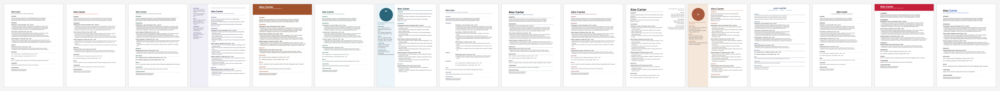

# Features

The full feature list. For a short summary and quick start, see the [root README](../README.md); for setup, see [INSTALLATION.md](INSTALLATION.md).

  

  Twelve résumé templates in two tiers: ATS-Safe (Classic · Swiss Minimal · Academic · Meridian · Throughline · Cadence · Regent) and Design (Atelier · Portrait · Lebenslauf · Aria · Saffron)

<strong>📝 Résumé &amp; cover-letter generation</strong>

- **Streaming generation** with 12 professional templates (7 ATS-Safe tier + 5 Design tier), DOCX / PDF / TXT export, ATS-safe formatting.
- **Universal "thinking" view**: see the model's reasoning stream live across **every** provider (Anthropic, OpenAI, Gemini, [Ollama][ollama], CLI agents), not just one.
- **Background generation**: switch tabs, close the modal, or navigate away; generation keeps running and the result is there when you come back.
- **Smaller PDFs**: fonts are glyph-subsetted per export (only the characters you actually use), shrinking a typical résumé PDF from ~3 MB to ~120 KB.

<strong>🎯 Matching, ATS &amp; analysis</strong>

- **Job search & matching**: Keyword search over your scraped postings, with vector similarity and LLM reranking _re-ordering_ the results when semantic ranking is enabled (off by default); separately, each posting is scored against your résumé.
- **Résumé analysis**: ATS scoring, skill-gap detection, language-mismatch warnings, and improvement recommendations.

<strong>🤖 Autopilot &amp; application tracking</strong>

- **Autopilot workflows**: define a search (board, query, location, schedule, filters); it finds and scores matching jobs.
- **Dedup + New/Applied badges**: re-running a workflow merges results by URL: prior finds are kept, genuinely new ones are badged **New**, and jobs you've marked as applied are badged **Applied** (generating documents alone doesn't count as applying).
- **One-click tailoring**: from any found job, click **Tailor** to seed the AI Generate workspace, open the posting, and mark it applied on any board. Generate a tailored résumé + cover letter and **résumé-grounded answers** to common application questions, with optional company research.
- **Documents / Activity**: every generated application is stored as a single per-job record (résumé, cover, answers, brief, board, date) and browsable in the **Documents** page (Résumés / Cover Letters / Activity tabs).

<strong>🌐 Browser extension (save jobs one-click)</strong>

- **Now on the Chrome Web Store and Firefox Add-ons**: <a href="https://chromewebstore.google.com/detail/ai-job-hunter-%E2%80%94-job-impor/oaoekkgkhmgdfnpmfkpphgiikliaicll" target="_blank" rel="noopener noreferrer">Install for Chrome</a> · <a href="https://addons.mozilla.org/en-US/firefox/addon/ai-job-hunter/" target="_blank" rel="noopener noreferrer">Install for Firefox</a>.
- MV3 extension for **Chrome & Firefox**: while browsing any job board, click the extension button to import the job into your saved applications.
- **One-click import**: click **"Import this job"** on any board page; the extension automatically captures the rendered DOM when possible (bypassing bot-walls on logged-in boards like LinkedIn/Indeed) and falls back to URL-only on restricted pages.
- **Assisted autofill** (opt-in, default off): fill empty contact fields on any application with your saved profile; enabled only in Settings → Browser extension.
- **Transport**: native messaging (primary) with loopback WebSocket fallback. Paired with mutual HMAC-SHA256 authentication (token used only as an HMAC key, never transmitted). Zero remote backend, zero analytics.
- See <a href="../apps/extension/README.md" target="_blank" rel="noopener noreferrer">apps/extension/README.md</a> for setup, dev pairing, and architecture. Try it locally: see the extension's <a href="../apps/extension/README.md#local-development--testing" target="_blank" rel="noopener noreferrer">Local development & testing</a> guide.

<strong>🔎 Company research (opt-in)</strong>

- Before writing a cover letter or answers, optionally research the company on the web, using your active AI provider's **own** web search (on Ollama, its web search needs an ollama.com account key) → a concise, factual brief: what they do, size/stage, products, mission, recent news. Order: the provider's own search → a SearXNG-compatible server you set (SearXNG or RustXNG, no key; queries go to that server) → [Exa](https://exa.ai) with your own key. The next one runs only when one fails on billing or sign-in; a SearXNG-compatible server's own failures never fall through ([ADR 0023](knowledge/decision-records/0023-web-search-is-a-separate-axis-from-the-ai-provider.md)).
- Default **off**, cached for a week, and treated as **untrusted** reference context: it never becomes a candidate fact, and the no-fabrication grounding rule still governs every claim.

<strong>🧠 AI providers &amp; local tuning</strong>

- **Multi-provider**: [Ollama][ollama] (local), OpenAI, Anthropic, Gemini, any OpenAI-compatible server (LM Studio, vLLM, remote [Ollama][ollama]), plus headless **CLI agents** (Claude Code, Codex, Gemini CLI).
- **Per-model local limits**: analyze a local model's real context window via [Ollama][ollama]'s `/api/show`, then set the context window + max output tokens per model, with a hardware-lag warning so large prompts aren't silently truncated.

<strong>🔒 Privacy &amp; data</strong>

- **Credentials in the OS keychain**: encrypted, never in plain text or config files.
- **All data local**: jobs, résumés, generations, applications in a local SQLite database; **no behavioural analytics**. Two things go out automatically: an update check and an **opt-out crash report**.
- **Full reset**: one action wipes every store (documents, generations, autopilots, contact/job preferences, caches, keychain entries) back to a clean install.
- **Multilingual**: UI in English & German; generation in 11 languages: en, de, fr, es, it, tr, pt, ru, zh, ja, ko.

[ollama]: https://ollama.com
